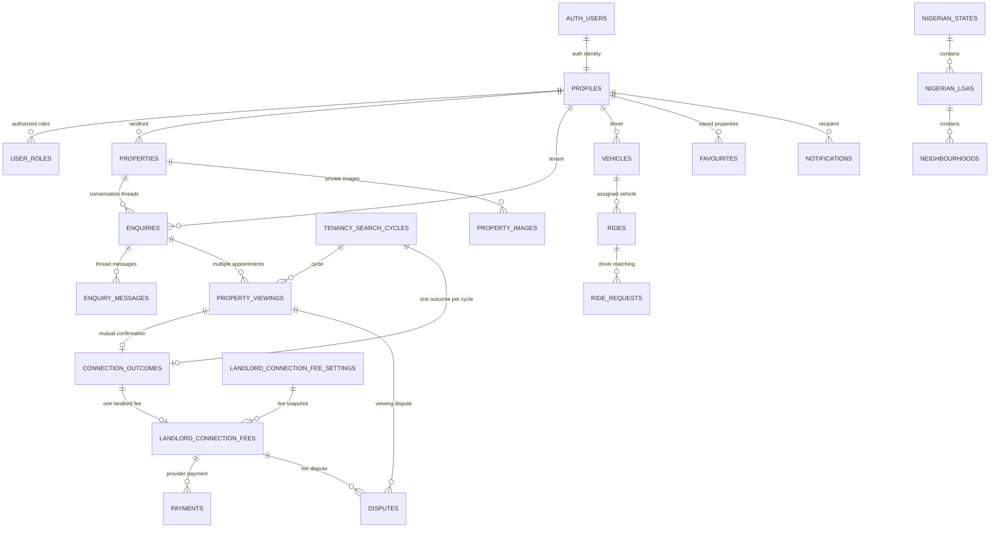

# MoVara Supabase migration package

This is a **review package**, not an applied database change. The repository
contains the Supabase schema and workflow package for the React web and Expo mobile clients. SQL
migrations must still be applied to the target project before the new profile
flows can persist data.

Review migration effects and take a database backup before applying these
changes to a hosted project.

## Migration order

1. `20261105000100_movara_core.sql` — auth profiles, roles, Nigerian locations,
   transport, property, identity verification, payment, notification, favourite,
   dispute, and audit base tables; client read policies; Nigeria location seed.
2. `20261105000200_property_viewings_and_fees.sql` — cycle, appointment,
   reschedule, confirmation evidence, effective-dated fee settings, connection
   outcomes, landlord fees, and payment/dispute links.
3. `20261105000300_secure_workflows_rls_storage.sql` — constrained
   `SECURITY DEFINER` owner, RLS/grants, transactional RPCs, verification/admin
   workflows, payment callback boundary, and private Storage bucket policies.
4. `20261106000100_backend_foundation.sql` — property bedroom/bathroom fields,
   driver availability profiles, owner-scoped initial writes, profile-photo
   bucket policies, notification read markers, and Realtime publication setup.
5. `20261109000100_role_profiles.sql` — customer, driver, and landlord profile
   details with self-only RLS and a manual identity submission transition.
6. `20261109000200_identity_submission_state.sql` — distinct submitted and
   pending review states, administrator review start, and rejected request retry.

The test files under `tests/` are pgTAP tests. `CONCURRENCY.md` describes
two-session race tests that cannot be faithfully represented by one serial
pgTAP transaction.

## Relationships and fee workflow

`property_viewings` has composite foreign keys to both the enquiry participants
and the cycle tuple. The cycle points to a property and its actual landlord.
This rejects a viewing whose property, landlord, or tenant does not match the
enquiry/cycle. A partial unique index allows only one `proposed`, `arranged`, or
`disputed` viewing in an enquiry at once.

The confirmation RPC records only the caller's own confirmation using database
time. It serializes requests by cycle and enquiry, locks the viewing row, then
creates the outcome, fee snapshot, and audit/event records in one transaction
when the second party confirms. Unique cycle, viewing, and outcome constraints
are the final retry/concurrency defenses. If the cycle already has an outcome,
the RPC returns that existing outcome and creates no second fee.

The landlord is the payer. Fees use integer kobo and `NGN`. A missing effective
fee setting creates an `awaiting_configuration` fee record; an authorized
administrator must assign an active setting before it can be paid. No fee
amount or due interval is embedded in client apps or schema defaults.
Enabled fee periods cannot overlap. Administrators can end a current period
before configuring its successor, or disable a future period; each change is
audited. Existing fee rows retain the amount, due interval, and setting ID
snapshot they were created with.

An enquiry is a durable thread; its initial and subsequent messages live in
`enquiry_messages`. Message creation uses a sender-scoped idempotency key and
notifies the other party. Neither an enquiry, a message, nor a phone click
creates a connection outcome or fee.

## Authorization model

- Supabase Auth creates a profile and a `customer` role only.
- Driver and landlord privileges require role request, administrator review, and
  server-authoritative role rows. An administrator role can only be provisioned
  through the `service_role`-only provisioning RPC.
- `authenticated` users cannot write viewing confirmations, cycles, outcomes,
  fees, fee settings, payments, audit records, roles, or verification decisions
  directly. They invoke narrowly scoped RPCs instead.
- Viewing read policies allow only the tenant, landlord, or administrator.
- Fee reads allow only the landlord and administrator. Tenant does not receive
  a fee record or payment obligation.
- `movara_workflow_owner` is `NOLOGIN`, `NOINHERIT`, and `NOBYPASSRLS`; it does
  not own the data tables. Each definer function uses an empty `search_path`,
  fully qualified object names, explicit actor/role checks, and explicit
  `EXECUTE` grants.
- Private Storage buckets use owner/property/document object-path checks.
  Property image reads are permitted for published properties or their owner;
  identity documents are private to the subject and authorized administrators.
- The payment Edge Function must verify provider signatures and event contents
  before calling either payment callback RPC. Before initiating a provider
  charge, it must call the service-role-only
  `prepare_landlord_fee_payment` RPC. That function locks the fee, rejects
  disputed or otherwise non-collectible fees, audits the preflight, and returns
  the authoritative landlord, amount in kobo, currency, and due date. The SQL
  callback functions check the trusted Supabase service-role JWT, expected
  landlord, amount, `NGN`, fee status, and idempotent provider event. Never put
  a service-role key in client apps.
- A database lock cannot be held safely across an external payment-provider
  request. A dispute may therefore open after preflight but before the provider
  completes a charge. Because provider authorization/capture semantics have
  not been selected, the current SQL boundary cannot guarantee that no external
  charge races with a newly opened dispute. Before launch, choose a provider
  and implement authorization followed by a fresh collectibility check before
  capture (or another provider-specific compensating flow). Do not treat
  preflight alone as a race-free payment authorization.
- Client-side role navigation is not authorization. Database policies
  and RPC checks are the security boundary.

## Tests and validation

SQL parsing, migration application, and pgTAP execution are **not verified** by
the client application test run. The pgTAP suite is a proposed test suite, not a passing
test result.

Use a disposable local Supabase project before any hosted deployment:

1. Install/use a reviewed Supabase CLI version and start its local services.
2. Apply the migrations to a fresh local database only.
3. Run `supabase test db`.
4. Run both-session scenarios in `tests/CONCURRENCY.md`.
5. Inspect RLS, Storage policies, RPC grants, and generated schema before any
   hosted migration.

No hosted project credentials, webhook secret, payment-provider credentials, or
service-role key belong in this repository.

## Rollback and recovery

These are forward migrations; no destructive `down.sql` is provided. Dropping
connection outcomes, fees, payment references, audit rows, or verification
history would destroy financial/legal evidence. Do not roll back by deleting
those records.

Before any hosted rollout:

- Take and verify a restorable database backup.
- Apply to a disposable local database and staging project first.
- Keep each migration transactionally deployable and use a later corrective
  migration for defects.
- For an emergency, disable affected RPC grants or the Edge Function and stop
  fee collection; preserve viewing, outcome, payment, and audit evidence.
- Any table/type removal requires a separately approved data-retention and
  migration plan.

## Decisions and assumptions still requiring confirmation

1. Fee amount and due interval are intentionally unset. Administrators will
   configure both with effective timestamps.
2. The first cycle is created transactionally with the tenant's first enquiry.
   Later cycles require the current cycle to be closed and an administrator
   to provide a reason; the database generates the new cycle UUID/number.
3. Cancelling before mutual confirmation prevents an outcome. Cancelling after
   mutual confirmation does not erase the outcome or fee; a fee remains
   collectible unless an administrator resolves a dispute with a waiver.
4. An elapsed `arranged` appointment is closed when a later appointment is
   created in the same enquiry. Proposed appointments do not expire
   automatically; parties must cancel them.
5. The location catalog seeds all 36 states and the FCT. The initial launch
   includes a reviewed regional neighbourhood set; additional LGA and
   neighbourhood data should be sourced and reviewed as coverage expands.
6. Payment provider, signature algorithm, webhook deployment, retry policy,
   refunds, chargebacks, and reconciliation are not selected here. The SQL
   callback only accepts an already-verified provider event.
7. Identity document types, retention periods, access logging/consent, and
   jurisdiction-specific KYC requirements require product/legal review.
8. The base schema defines the transport/property records and safe read
   boundaries, but does not yet include every CRUD/matching RPC needed to move
   the current client application modules to production. Those belong in
   separately reviewed migrations.
9. Administrator role provisioning is trusted-server only. Administrator
   account recovery, key custody, and break-glass procedures need an operator
   policy before launch.
10. Property rent prices are stored in kobo, but billing period (monthly,
    yearly, or another term) is not yet modeled and must be decided before
    publishing rent listings.
